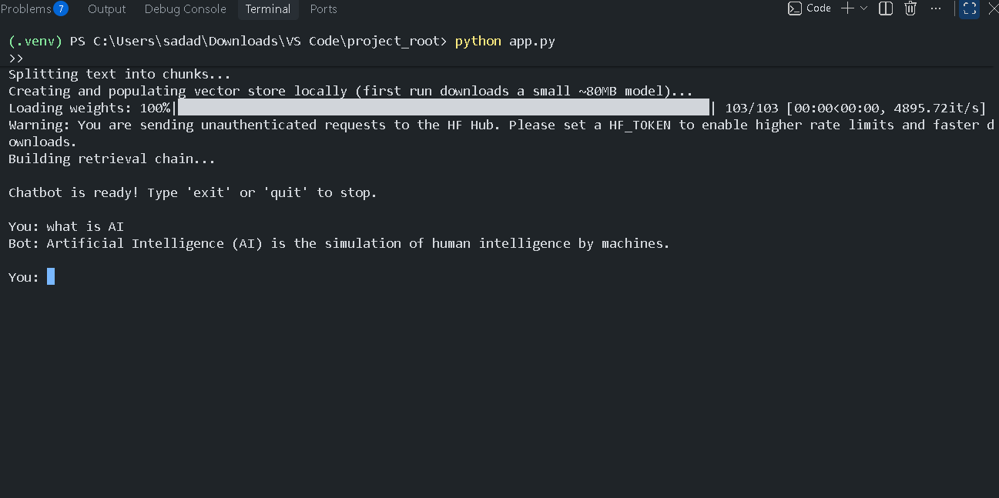

# LangChain PDF RAG Chatbot

A Retrieval-Augmented Generation (RAG) document chatbot built with **LangChain**, **Groq (`openai/gpt-oss-120b`)**, **HuggingFace Embeddings**, and **ChromaDB**. It processes PDF documents into searchable vector embeddings and answers user questions grounded strictly in the document's content.

## Screenshot



## Features
- **PDF Ingestion & Text Chunking:** Loads PDF files with `PyPDFLoader` and splits text into overlapping chunks via `RecursiveCharacterTextSplitter`.
- **Local Vector Embeddings:** Generates dense embeddings locally using HuggingFace (`all-MiniLM-L6-v2`) and stores them persistently in **ChromaDB**.
- **Fast Context-Grounded Q&A:** Retrieves the most relevant document passages and generates accurate responses using **Groq (`openai/gpt-oss-120b`)**.

## Tech Stack
- **Python 3.11**
- **LangChain** (`langchain`, `langchain-classic`, `langchain-community`)
- **Groq API (`langchain-groq`)** (LLM inference)
- **HuggingFace (`langchain-huggingface`, `sentence-transformers`)** (Local text embeddings)
- **ChromaDB** (Persistent vector database)
- **PyPDF & Python-Dotenv** (PDF parsing & environment variable management)

## Project Structure
```text
langchain-pdf-rag-chatbot/
├── data/
│   └── document.pdf
├── app.py
├── requirements.txt
├── Screenshot.png
├── .gitignore
└── README.md
```

## Setup & Installation
1. Clone the repository:
   ```bash
   git clone https://github.com
   cd langchain-pdf-rag-chatbot
   ```
2. Create and activate a virtual environment:
   ```bash
   python -m venv .venv
   # Windows:
   .\.venv\Scripts\activate
   # macOS/Linux:
   source .venv/bin/activate
   ```
3. Install dependencies:
   ```bash
   pip install -r requirements.txt
   ```
4. Create a `.env` file in the root folder and add your Groq API key:
   ```env
   GROQ_API_KEY=your_groq_api_key_here
   ```
5. Place your target PDF inside the `data/` folder named `document.pdf` (`data/document.pdf`).
6. Run the chatbot:
   ```bash
   python app.py
   ```
